# WPX newsletter discovery and Cloudflare handoff

Verified on 28 October 2026, Australia/Perth. This document supplies the missing hosted-source context for the chat **Outline migration status**. The goal is to remove the PHP dependency on dev.musclehacking.com while preserving newsletter signup, email confirmation, and the existing GetResponse destination.

## Conclusion

The WPX application is a standalone relay. It verifies a Google reCAPTCHA token, then calls GetResponse's contacts API. It does not run WordPress, send confirmation emails, store subscribers locally, or implement an email-confirmation link.

GetResponse's live, read-only API confirms that **qwsfu is the API campaignId**, the list is named **musclehacking**, and API subscriptions use **double opt-in**. Double opt-in means the reader must click the link in a confirmation email before joining the list. This resolves the earlier uncertainty about whether the public form token was also a valid API list ID.

The existing Cloudflare candidate already separates the same responsibilities: Turnstile checks for bots, a Worker handles the request, and GetResponse manages the list and confirmation email. Turnstile alone does not replace the PHP relay or prove ownership of an email address.

## Current flow and replacement

```mermaid
flowchart TD
  subgraph Current[Current production flow]
    A[Reader submits the public website form] --> B[Google reCAPTCHA returns a token]
    B --> C[PHP handler on dev.musclehacking.com]
    C --> D[Google verifies the token]
    D --> E[GetResponse list musclehacking: qwsfu]
    E --> F[Website tells reader to check email]
    E --> G[GetResponse sends the confirmation email]
    G --> H[Reader confirms through GetResponse]
  end
  subgraph Candidate[Cloudflare candidate]
    I[Reader submits the Astro form] --> J[Invisible Turnstile returns a token]
    J --> K[Cloudflare Worker at /api/subscribe]
    K --> L[Cloudflare verifies the token]
    L --> M[GetResponse list and email confirmation]
    M --> N[Worker redirects to /one-last-step/]
  end
```



The branches after the GetResponse request describe separate browser and email outcomes. Source inspection and configuration readback establish the intended process; no new subscription or email delivery was tested during discovery.

## Verified access and files

- Hosting: WPX service 7836, Professional plan under electricalknowledge.com.
- Dedicated account created with the user's approval: agent.ftp@dev.musclehacking.com.
- SFTP: s15.wpxhosting.com, IP 198.60.193.15, port 2222.
- SFTP root: /, scoped to dev.musclehacking.com. Do not infer a physical server directory from this virtual root.
- Connection record: /Users/sacino/ranked-ai-builder/sites/dev-musclehacking/site.md.
- The FTP password is saved only in the Git-ignored /Users/sacino/ranked-ai-builder/.env. Never display or source that file. Use /Users/sacino/ranked-ai-builder/scripts/wpx-sftp for transfers.

| Remote file | Size | Responsibility |
| --- | ---: | --- |
| /subscription-handler.php | 3,994 bytes | Origin gate, reCAPTCHA verification, GetResponse request, JSON result |
| /config_123123123.php | 250 bytes | Defines RECAPTCHA_SECRET_KEY and GETRESPONSE_API_KEY |
| /error_log.txt | 152 bytes | Optional application log; not downloaded or read |

The root contains no WordPress directories. The handler's only include is the configuration PHP file. Logging is disabled in the inspected source. The complete handler and a configuration snapshot with both secret values removed are in [the source record](wpx-newsletter-source.md).

## Exact legacy request and response contract

The live public homepage form uses POST with multipart FormData. Its destination is the PHP handler on dev.musclehacking.com. It supplies email, campaign_token=qwsfu, start_day=0, the current page as custom_signup_url, the One Last Step page as thankyou_url, and g-recaptcha-response.

The public /js/humans-only.js intercepts form submission, runs reCAPTCHA with action **submit**, appends the returned token, sends the request, parses JSON, and navigates to the returned thankYouUrl when success is true. A rejected response shows a generic submission alert. Network or JSON failure shows a separate generic processing alert.

The homepage already loads Google's reCAPTCHA script before a form is submitted. Only token execution waits for submission. The candidate's decision to load Turnstile on submission is a change in loading time, not a faithful copy of the legacy script-loading behaviour.

### What the PHP handler actually uses

1. Includes the two secrets from DOCUMENT_ROOT/config_123123123.php.
2. Requires method POST and Origin exactly equal to the production www HTTPS origin. Other methods, missing Origin, and other origins return 403 with an error of Not Allowed. Allowed requests receive the matching Access-Control-Allow-Origin header.
3. Requires a non-empty g-recaptcha-response. A missing token returns 400.
4. Posts the reCAPTCHA secret, response token and PHP REMOTE_ADDR to Google's siteverify endpoint. It checks only the returned success boolean. It does not check score, action, or hostname.
5. Reads email from the submitted form without its own format or length validation.
6. Posts JSON to GetResponse's /v3/contacts endpoint, authenticated with X-Auth-Token and the configured API key. The body contains only email, dayOfCycle="0", and campaign.campaignId="qwsfu".
7. Treats HTTP 202 as success. Every HTTP 409 becomes a visible duplicate failure. Other provider statuses become HTTP 500 with a generic provider error plus its HTTP status.
8. On success, returns JSON containing success=true, a success message, and a hardcoded thankYouUrl pointing to the production One Last Step page. The script does not issue the browser redirect itself.

The server ignores campaign_token, start_day, custom_signup_url and thankyou_url. The destination list, autoresponder day and thank-you page are hardcoded. The hidden fields are therefore not authority for those settings.

There are no explicit outbound timeouts, request-size limits, rate limits, honeypot, database calls, email sending, or subscriber-file writes in this application. PHP/network defaults may still apply. REMOTE_ADDR is supplied to Google only; it is not included in the GetResponse body and might identify a proxy rather than the reader behind Cloudflare.

Without JavaScript, the browser cannot generate a reCAPTCHA token. A native form POST therefore cannot complete the legacy verification. The earlier migration requirement for successful signup without JavaScript does not describe existing production behaviour.

### Legacy outcomes

| Condition | HTTP status | Body or browser outcome |
| --- | ---: | --- |
| Non-POST or unapproved/missing Origin | 403 | error: Not Allowed |
| Missing reCAPTCHA response | 400 | error: Bad Request: Missing reCAPTCHA response. |
| Failed reCAPTCHA verification | 401 | error: reCAPTCHA verification failed. |
| GetResponse returns 409 | 409 | error: Email already subscribed or exists in the campaign. |
| Other GetResponse result except 202 | 500 | Generic provider failure with provider HTTP status |
| GetResponse returns 202 | 200 | success=true; browser navigates to /one-last-step/ |

Only the harmless GET rejection was exercised live: it returned 403 with the exact expected JSON body. It reports text/html rather than application/json because the method/origin rejection occurs before the handler sets its JSON content type. All POST outcomes above are established from source, not new subscriber submissions.

## GetResponse configuration readback

The existing API key was used in memory for GET /v3/campaigns/qwsfu. The request returned HTTP 200. No contact was created or fetched, and no campaign setting changed.

| Setting | Verified value |
| --- | --- |
| campaignId | qwsfu |
| List name | musclehacking |
| Language | EN |
| API opt-in | double |
| Web form opt-in | double |
| Email/import opt-in | single / single |
| Confirmation format | text/plain |
| Confirmation destination type | hosted by GetResponse |
| Custom confirmation redirect URL | Empty |
| Confirmation body resource | TfUp |
| Confirmation subject resource | yrjU |

The hosted destination means this list does not currently depend on a custom confirmation callback on dev.musclehacking.com. The existing list can retain its confirmation settings when the request handler changes. API acceptance alone still does not prove inbox delivery or completed confirmation.

The API key exists and works for this read. It was not copied into Cloudflare, committed, printed, or retained in the source snapshot. Retrieve it again through the approved WPX wrapper if the migration task is authorised to configure a Worker secret. Never print the configuration file without redacting values first. The old Google secret is unnecessary for Turnstile.

## Cloudflare candidate: preserved behaviour and differences

Source inspected at Muscle Hacking revision b0ef37717a7dcde41d63003c3ccbee1a9664c25f:

| Responsibility | Legacy PHP | Existing Cloudflare candidate |
| --- | --- | --- |
| Request handler | PHP file on WPX | src/pages/api/subscribe.ts on the Worker |
| Bot check | Google reCAPTCHA; checks success only | Invisible Turnstile; verifies success, matching hostname, action subscribe |
| Subscriber destination | Hardcoded qwsfu | GETRESPONSE_CAMPAIGN_ID runtime value |
| Provider and autoresponder | GetResponse v3 contacts; day 0 | Same endpoint and day 0 |
| Email confirmation | GetResponse list has API double opt-in | Preserved if production uses qwsfu; preview needs its own double-opt-in test list |
| Successful browser result | JSON then JavaScript navigation | Native 303 redirect to /one-last-step/ |
| Duplicate | Any 409 is an error | 409 with code 1008 is treated as success |
| Reader IP sent to GetResponse | No | Yes, when CF-Connecting-IP is present |
| Input protection | Browser validation, origin, challenge | Server validation, bounded body, allowed fields/source paths, honeypot, origin, challenge |
| External request limits | No explicit timeouts | 5 seconds for Turnstile, 8 seconds for GetResponse |
| Without JavaScript | Cannot pass the challenge | Cannot pass the challenge |

Relevant source files are src/components/NewsletterForm.astro, src/scripts/newsletter-challenge.ts, src/features/newsletter/schema.ts, src/features/newsletter/request-body.ts, src/features/newsletter/provider.ts and src/pages/api/subscribe.ts. The candidate's campaign form field is a local form label, not the provider list ID; the environment controls the real destination.

The candidate uses Cloudflare dummy test secrets to bypass hostname/action binding in local tests. A real preview/production deployment must use the real secret and enforce those checks. This discovery did not inspect live Cloudflare bindings or deploy new code. The 22 October migration record says GetResponse credentials are absent from the preview Worker; that runtime fact must be rechecked during implementation.

## What the migration task must verify next

1. Configure an isolated preview GetResponse list, API double opt-in, and an approved test recipient. Never point preview acceptance tests at qwsfu.
2. Configure the appropriate Worker secrets securely. The WPX API key is recoverable; do not ask the user to paste it in chat. For eventual production, qwsfu is the verified existing list ID.
3. Keep duplicate handling and the newly forwarded IP address visible as behaviour changes. Decide whether to preserve the candidate's choices rather than calling them exact legacy equivalence.
4. In an authorised preview test, prove a valid Turnstile submission creates a pending subscription in the test list, reaches /one-last-step/, delivers the email, and completes confirmation after the reader follows the link. Then verify the day-0 autoresponder behaviour.
5. Check the closest failure paths on that isolated list: invalid/expired/replayed challenge, duplicate signup, provider rejection and timeout. Check the no-JavaScript requirement against the recorded product decision.
6. Retain the PHP relay, DNS and this connection through migration acceptance and the rollback period. Retiring the WPX service is outside this discovery task.

No application code, public form, DNS record, subscriber data, or Cloudflare setting changed during discovery. The authorised FTP account creation was the only remote write. This report and its source record provide the context for the migration chat without sending it a message.

## Primary references

Cloudflare requires server verification; its tokens expire after five minutes and are single-use. A Worker must validate the returned hostname and action before contacting GetResponse.

[Cloudflare: validate the Turnstile token](https://developers.cloudflare.com/turnstile/get-started/server-side-validation/)
```text
https://developers.cloudflare.com/turnstile/get-started/server-side-validation/
```

GetResponse documents separate opt-in settings for API and HTML-form subscriptions. The live readback above verifies API double opt-in for this exact list.

[GetResponse: opt-in settings](https://www.getresponse.com/help/how-can-i-edit-opt-in-settings.html)
```text
https://www.getresponse.com/help/how-can-i-edit-opt-in-settings.html
```

GetResponse documents authenticated, read-only retrieval of a campaign by its campaignId.

[GetResponse: campaign readback](https://apidocs.getresponse.com/v3/quick-start)
```text
https://apidocs.getresponse.com/v3/quick-start
```
